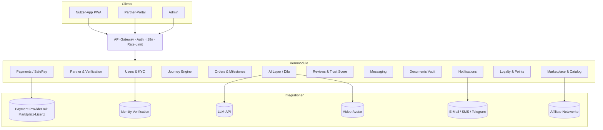

# GTA ONE – Technisches Konzept für das MVP

## 1. Zielbild

Mobile-first Web App (PWA) mit drei Oberflächen auf einem Backend:

- **Nutzer-App**: Journey, Marktplatz, Buchung, Aufträge, Services, Punkte, Dila AI
- **Partner-Portal**: Profil, Leistungen, Aufträge, Nachweise, Nachrichten, Kennzahlen
- **Admin**: Verifizierung, Kategorien, Transaktionen, Beschwerden, Bewertungen, Inhalte, KPIs

Mehrländer-, Mehrsprachen- und Mehrwährungsfähigkeit ist Konfiguration, nicht Code (Land, Sprache, Währung, Kategorie als Stammdaten).

## 2. Architektur

**Stack-Vorschlag:** Next.js + TypeScript (Web, PWA), NestJS (API, modularer Monolith), PostgreSQL, Redis (Queues), S3-kompatibler Objektspeicher in der EU, Hosting in Deutschland. Ein modularer Monolith reicht für das MVP; Module mit klaren Grenzen lassen sich später herauslösen.

## 3. Datenmodell (Kern)

| Entität | Wichtige Felder |
|---|---|
| `user` | id, name, phone, email, country, language, kyc_status, tier, points_balance |
| `journey_profile` | user_id, goal, profession, target_city, has_contract, marital_status, visa_status |
| `journey_task` | id, user_id, phase (1–8), title_i18n, category_id, status, due_date |
| `partner` | id, legal_name, country, level (verified/pro/operator), status (pending/active/suspended), trust_score |
| `verification_item` | partner_id, type (register, id, address, bank, license, insurance, terms), status, expires_at |
| `service` | id, partner_id, category_id, name_i18n, price, currency, delivery_days, milestone_template |
| `order` | id, user_id, partner_id, service_id, total, currency, status, dispute_status |
| `milestone` | order_id, seq, label, amount, state (held/proof/released/refunded), proof_document_id |
| `payment` | order_id, psp_reference, amount, state, captured_at |
| `review` | order_id (Pflicht → Verified Purchase), ratings (Qualität, Tempo, Preis, Kommunikation), text, moderation_state |
| `document` | owner (user/order), storage_key, type, check_state, retention_until |
| `message` | order_id, sender, body, flags (z. B. Barzahlung erkannt) |
| `points_ledger` | user_id, delta, reason, reference |

## 4. Kernlogik

- **Journey Engine:** Regelwerk (JSON/DB) aus Profilmerkmalen → Aufgaben je Phase mit verknüpfter Kategorie. Aktuelle Phase = erste mit offenen Aufgaben. Später KI-gestützte Ergänzung.
- **SafePay:** Gesamtbetrag wird beim Provider eingezogen und für den Partner reserviert (Treuhand / Marketplace-Split). Partner lädt Nachweis → Kunde bestätigt oder Auto-Freigabe nach Frist → Auszahlung. Beschwerde friert alle offenen Meilensteine ein; Admin entscheidet: Erstattung oder Freigabe. GTA hält keine Kundengelder auf dem eigenen Geschäftskonto.
- **Trust Score:** gewichtete Kennzahl aus Bewertungen, Beschwerde-, Storno- und Erstattungsquote, Verspätungen, Reaktionszeit. Unter Schwellwert → automatische Prüfung, Entzug des Status möglich.
- **Punkte:** Ledger-basiert (keine Salden-Updates ohne Buchung). 1 Punkt pro €, +100 je Phase, +50 je Bewertung, +500 je geworbener Nutzer. 100 Punkte = 1 €, max. 10 % Rabatt pro Buchung.
- **Betrugsschutz:** Nachrichten-Scan auf Barzahlungs-/Off-Platform-Hinweise, auffällige Bewertungen in Moderations-Queue, Warnsignale bei Partner-Anträgen.

## 5. Recht & Compliance (vor Livegang klären)

- Zahlungsabwicklung nur über ZAG-/E-Geld-lizenzierten Provider mit Marktplatz-Modell.
- Versicherungen und Finanzprodukte: Tippgeber-/Affiliate-Modell, Beratung beim Partner mit Erlaubnis (§ 34d / § 34c GewO).
- Rechtsberatung nur durch zugelassene Partner (RDG).
- Arbeitsvermittlung: Vergütungsregeln für Vermittlung aus Drittstaaten beachten.
- DSGVO: Datenhaltung EU, Einwilligungen, Löschfristen für Dokumente, AV-Verträge mit Partnern.
- Kennzeichnung von Werbung, Affiliate-Links und Sponsored Placements.

## 6. Backlog nach Sprints (je 2 Wochen, Schätzung)

| Sprint | Aufgaben | Ergebnis |
|---|---|---|
| 0 · Setup | Repo, CI/CD, Umgebungen, Design-System, i18n UZ/RU/DE/EN, Auth (Telefon + E-Mail, OTP) | Grundgerüst in EU-Hosting |
| 1 · Profil & Journey | Onboarding, Profil, Journey-Regelwerk, Aufgabenstatus, Admin-Editor für Regeln | My Journey live |
| 2 · Katalog | Kategorien, Partnerprofile, Leistungen, Suche, Filter, Sortierung nach Trust Score | Marktplatz lesbar |
| 3 · Buchung & SafePay | Order-Modell, Meilensteine, PSP-Integration (Sandbox), Belege, Webhooks | Testzahlung End-to-End |
| 4 · Abwicklung | Dokumenten-Tresor, Nachweise, Messaging, Benachrichtigungen (E-Mail/SMS/Telegram) | Auftrag komplett abwickelbar |
| 5 · Portale | Partner-Portal, Verifizierungs-Workflow, Admin (Freigabe, Sperre, Beschwerden, Moderation) | Partner-Onboarding |
| 6 · Bindung & Launch | Bewertungen, Punkte-Ledger, Dila (LLM + Wissensbasis), Videos, Analytics, Security-Review, Pen-Test | Closed Beta |

Kernteam-Annahme: 2 Full-Stack, 1 Design, 1 Product Owner, QA in Teilzeit; Rechtsprüfung parallel.

## 7. Vom Prototyp zum Produkt

Der Prototyp in `app/index.html` bildet Oberflächen und Abläufe ab. Für das Produkt werden die Beispieldaten durch die API ersetzt, die regelbasierte Dila-Logik durch ein Sprachmodell mit Journey-Kontext und geprüfter Wissensbasis, und alle Zahlungs-, KYC- und Dokumentenfunktionen durch die Integrationen oben.
